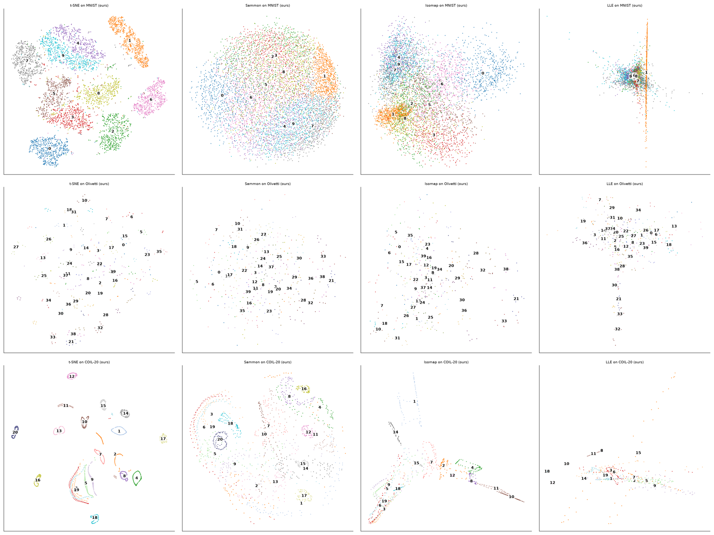

# t-SNE from scratch: a partial reproduction of van der Maaten & Hinton (2008)

**Paper:** L. van der Maaten and G. Hinton. *Visualizing Data using t-SNE.* Journal of Machine Learning Research 9(86):2579–2605, 2008. [jmlr.org/papers/v9/vandermaaten08a.html](https://jmlr.org/papers/v9/vandermaaten08a.html)

COMP3314 Introduction to Machine Learning (HKU, 2026–27) group project, Group 35: Jelisaveta Vasiljevic, Alexandre Bommensath, Anna Claire Breuss-Burgess, Adel Kussainova.

Repository: https://github.com/LizaaV/tsne-from-scratch

## Repository layout

| Folder | What it is |
|---|---|
| `resources/` | Our from-scratch t-SNE, the correctness checks, and experiments E1–E7 on scikit-learn's small digits set, with their figures and results |
| `submission/code/` | The runs on the paper's own data sets: E8 (MNIST-6000) and the Section 4 comparison on MNIST, Olivetti and COIL-20. `tsne.py` is an unmodified copy of `resources/tsne.py`; `experiments.py` differs only in where it writes its outputs |
| `submission/outputs/` | Figures, numbers and the run log from those runs. `compare3/REPORT.md` is the full write-up of the comparison |
| `submission/report/` | The written report (LaTeX source and PDF) |

## What is here

| File | What it is | Ours or reused |
|---|---|---|
| `resources/tsne.py` | t-SNE in NumPy: perplexity binary search (Eq. 1), symmetrised $p_{ij}$ (§3.1), Student-t $q_{ij}$ (Eq. 4), gradient (Eq. 5), optimiser of §3.4 (momentum, Jacobs gains, early exaggeration); symmetric SNE as an option; Sammon mapping (§6.1); PCA | **ours**, written from the paper's equations |
| `resources/check_gradient.py` | finite-difference check of the gradient; perplexity check | ours |
| `resources/worked_example.py` | a 3-point example small enough to check by hand | ours |
| `resources/experiments.py` | experiments E1–E8 below | ours; uses scikit-learn for Isomap, LLE, its own t-SNE (cross-check only), 1-NN classifier, trustworthiness |
| `resources/demo_live.py` | animated run for the presentation | ours |
| `resources/e10_sigma.py` | E10: median $\sigma_i$ per cluster on E7's three clusters (critical analysis, Extension 3) | ours |
| `submission/code/compare3.py` | the paper's Section 4 comparison (Figures 2–5) on MNIST, Olivetti and COIL-20, with numbers added | ours; uses scikit-learn for Isomap, LLE, trustworthiness and the data loaders |
| `resources/figures/`, `resources/results/` | outputs of `resources/experiments.py` (E1–E7) | generated |
| `submission/outputs/` | outputs of E8 and of `compare3.py` | generated |
| `submission/report/figures/` | the two figures of the critical analysis (method map; sizes and gaps from E7 and E10), drawn in TikZ; sources in `figures/source/` | ours |

## Ours and reused

- **Ours:** every file in the table above. No code was copied from the authors' Matlab implementation or from scikit-learn's t-SNE.
- **Reused libraries:** NumPy, SciPy, matplotlib, Pillow, and scikit-learn (Isomap, LLE, the 1-NN classifier, trustworthiness, the data loaders, and its own t-SNE as a cross-check only).
- **Data:**
  - digits: bundled with scikit-learn (UCI Optical Recognition of Handwritten Digits).
  - MNIST: LeCun, Cortes and Burges, downloaded from OpenML (`mnist_784`).
  - Olivetti faces: AT&T Laboratories Cambridge, downloaded through scikit-learn.
  - COIL-20: Nene, Nayar and Murase (1996), Columbia University CAVE, [coil-20-proc.zip](https://www.cs.columbia.edu/CAVE/databases/SLAM_coil-20_coil-100/coil-20/coil-20-proc.zip).
- **Report template:** the official NeurIPS 2026 style file, `submission/report/extra/neurips_2026.sty`.

## Setup and running

```bash
python -m venv venv && source venv/bin/activate
pip install -r resources/requirements.txt

# E1-E7 and the checks (small digits set, no download)
cd resources
python check_gradient.py          # about 5 s
python experiments.py all         # E1-E7, about 15-20 min on a laptop
python demo_live.py --perplexity 30

# E8 and the three-data-set comparison (the paper's own data sets)
cd ../submission/code
pip install "pandas<3"            # pandas 3 breaks scikit-learn's MNIST loader
python experiments.py mnist       # E8: MNIST-6000, about 2 min; downloads MNIST the first time
# if the download fails with a certificate error: MNIST_NPZ=/path/to/mnist.npz python experiments.py mnist
python compare3.py                # MNIST, Olivetti, COIL-20; about 30 min (Sammon on MNIST takes most of it)
```

`compare3.py` needs COIL-20 on disk first: download `coil-20-proc.zip` (link above) and unzip it into `submission/data/coil-20/`. That folder is not tracked in git. MNIST and Olivetti download automatically.

Tested with Python 3.7, NumPy 1.21, scikit-learn 1.0, matplotlib 3.5.

## Data

The paper uses MNIST (6,000 of 60,000 images, 28 × 28), Olivetti faces and COIL-20. We use two sets of data:

- **Small digits set** (E1–E7): scikit-learn's bundled digits, 1,797 images, 8 × 8 = 64 pixels, 10 classes. Same kind of data, no download, and small enough to run every experiment several times.
- **The paper's three data sets** (E8 and `compare3.py`):
  - MNIST: 6,000 images drawn with seed 0 from all 70,000 OpenML images, 28 × 28 = 784 pixels.
  - Olivetti faces: 400 images of 40 people, scikit-learn's copy at 64 × 64 = 4,096 pixels (the paper used 92 × 112).
  - COIL-20: 1,440 images of 20 objects, reduced from 128 × 128 to 32 × 32 = 1,024 pixels by averaging each 4 × 4 block.

## Settings (as in the paper)

PCA to 30 dimensions → perplexity 40 → $Y^{(0)} \sim \mathcal N(0, 10^{-4}I)$ → 1,000 iterations, learning rate 100 with Jacobs (1988) gains (+0.2 / ×0.8, minimum 0.01), momentum 0.5 for $t < 250$ and 0.8 after, early exaggeration ×4 for 50 iterations. Isomap and LLE: $k = 12$. Sammon: 500 iterations of Sammon's diagonal Newton method.

## Results

All numbers in this section are ours unless a line says "Paper".

### The paper's Section 4 comparison on its three data sets (Figures 2–5)

The paper judges these maps by eye and reports no numbers for them. We added two scores: 1-NN error on the 2-D map (10-fold cross-validation) and trustworthiness.

1-NN error on the 2-D map (lower is better):

| Method (same PCA-30 input) | MNIST (6,000) | Olivetti (400) | COIL-20 (1,440) |
|---|---|---|---|
| **t-SNE (ours)** | **5.92%** | **6.25%** | **3.61%** |
| Sammon (ours) | 57.97% | 64.00% | 30.35% |
| Isomap (scikit-learn) | 53.75% | 64.25% | 20.92%† |
| LLE (scikit-learn) | 61.68% | 60.75% | 18.75%† |
| *Raw pixels (no map)* | *6.03%* | *5.00%* | *4.79%* |

Trustworthiness, $k = 12$ (higher is better):

| Method | MNIST | Olivetti | COIL-20 |
|---|---|---|---|
| **t-SNE (ours)** | **0.986** | **0.945** | **0.997** |
| Sammon (ours) | 0.788 | 0.869 | 0.915 |
| Isomap (scikit-learn) | 0.788 | 0.852 | 0.943† |
| LLE (scikit-learn) | 0.700 | 0.716 | 0.880† |

† On COIL-20, Isomap and LLE map only the largest connected part of the $k = 12$ neighbour graph: 1,152 of 1,440 points, 16 of 20 objects. The raw-pixel error on that same subset is 5.99%.

One run per method, seed 0. The maps match the paper's descriptions of Figures 2–5. Full write-up, limitations and run times: `submission/outputs/compare3/REPORT.md`.



### E1: t-SNE vs Sammon, Isomap, LLE, PCA on the small digits set

| Method (same PCA-30 input) | 1-NN error, 10-fold CV | Trustworthiness ($k = 12$) | Time (s) |
|---|---|---|---|
| t-SNE (ours) | 1.9% | 0.992 | 93.4 |
| t-SNE (scikit-learn) | 2.1% | 0.993 | 10.6 |
| LLE k=12 | 23.3% | 0.879 | 0.4 |
| Isomap k=12 | 30.0% | 0.857 | 3.2 |
| Sammon (ours) | 41.7% | 0.858 | 172.8 |
| PCA | 42.5% | 0.832 | 0.0 |
| original 64-D pixels (no map) | 2.5% | n/a | n/a |

Figure: `resources/figures/E1_compare_methods.png`.

### Other experiments

E2–E7 use the small digits set; their figures are in `resources/figures/`. E8's figure is in `submission/outputs/figures/`.

| # | Question | Result | Figure |
|---|---|---|---|
| E2 | Does Figure 1 come out of the formulas? | yes in shape; SNE max attraction 20.0 vs max repulsion 0.86 (paper ≈ 19 vs 1) | `E2_gradients_fig1.png` |
| E3 | Is the Student-t really what fixes crowding? | yes: same everything, Gaussian map kernel → 1-NN 8.2%, Student-t → 1.9% | `E3_crowding_sne_vs_tsne.png` |
| E4 | Perplexity 5 / 15 / 40 / 100 | 1-NN 2.3%, 2.2%, 1.9%, 2.2%; the picture changes a lot | `E4_perplexity.png` |
| E5 | Does early exaggeration help? | slightly on digits: KL 0.638 vs 0.663, 1-NN 1.9% vs 2.2% | `E5_*.png`, `E5_tsne_animation.gif` |
| E6 | Run-to-run variation (5 seeds) | KL 0.637 ± 0.004, 1-NN 2.1 ± 0.1%; layout changes | `E6_seeds.png` |
| E7 | Are cluster sizes and gaps preserved? (our extension) | no: true spread ratio 5.1 → 1.4; gap ratio 5.2 → 3.4 | `E7_sizes_and_gaps.png` |
| E10 | Do the bell widths $\sigma_i$ keep the cluster sizes the map drops? (our extension; `resources/e10_sigma.py`) | mostly: median-$\sigma_i$ ratio 4.1 (true 5.1) for B/A and 5.0 (true 5.1) for C/A; pairs joining B and C hold $3.6 \times 10^{-7}$ of $P$ | none (numbers in `resources/results/E10_sigma.json`) |
| E8 | MNIST-6000 as in the paper | 1-NN error 5.92% on the 2-D map vs 6.03% on the 784-D pixels; final KL 1.374; 118 s | `E8_mnist6000.png` |

Paper (MNIST, §5): 1-NN error 5.13% on the 2-D map vs 5.75% in 784-D. That number comes from random-walk t-SNE using all 60,000 digits, so the setup differs from E8, but the conclusion is the same: the map classifies about as well as the original images.

## Correctness checks

- **Gradient:** analytic gradient (Eq. 5) against central finite differences on a random 40-point problem: relative difference $6.8 \times 10^{-9}$ (Student-t) and $2.1 \times 10^{-9}$ (Gaussian / symmetric SNE).
- **Perplexity search:** every row reaches the target perplexity 10 to within $10^{-4}$.
- **Outlier guarantee (§3.1):** $\sum_j p_{ij} > 1/2n$ for every point.
- **Against scikit-learn:** same input and settings give the same 1-NN error and trustworthiness to within about 0.1 percentage points and 0.001 (E1).
- **Determinism:** the MNIST t-SNE run inside `compare3.py` gives the same result as E8 (KL 1.374, 1-NN 5.92%).

## Discrepancies with the paper, and challenges

- **Sign of the update.** Algorithm 1 (and the SNE update in §2) prints $Y^{(t)} = Y^{(t-1)} + \eta\,\partial C/\partial Y + \ldots$, which is gradient ascent. We use $-\eta\,\partial C/\partial Y$.
- **Figure 1 normalisation** is not given in the paper. With unnormalised unit-width kernels our SNE panel has max attraction 20 and max repulsion 0.86 (paper: about 19 and 1). Our t-SNE panel spans ±0.65 where the paper's colour bar shows ±1. The shapes agree.
- **Appendix A** drops a factor $d_{ij}$ twice in its intermediate steps. The final gradient is right, as our finite-difference check confirms.
- **Jacobs gains:** the paper names the scheme but not its constants. We use the common +0.2 / ×0.8 / 0.01.
- **Data differences:** our MNIST sample is drawn from all 70,000 images (the paper: 6,000 of the 60,000 training images, no seed given); our Olivetti images are 64 × 64 (the paper: 92 × 112); the COIL-20 resize to 32 × 32 is ours, because the paper does not say how it was done.
- **COIL-20 neighbour graph:** with $k = 12$ the graph splits into 5 parts, so Isomap and LLE drop objects 13, 16, 17 and 20.
- **Olivetti:** t-SNE's map is slightly worse than the raw pixels there (6.25% vs 5.00%, which is 25 vs 20 errors on 400 points). On MNIST and COIL-20 it is slightly better.
- **Run time:** our $O(n^2)$ NumPy version needs about 95 s for the 1,797 digits (scikit-learn's Barnes–Hut version: about 11 s) and about 90 to 120 s for MNIST-6000. Our Sammon mapping needs about 26 min on MNIST-6000.
- **Not reproduced:** random-walk t-SNE (§5) and the supplementary comparisons (CCA, MVU, Laplacian Eigenmaps).
